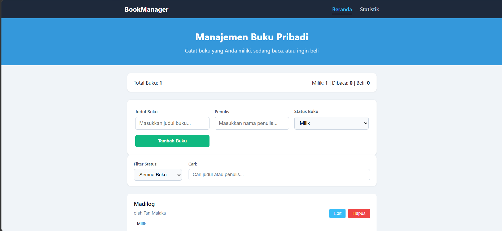
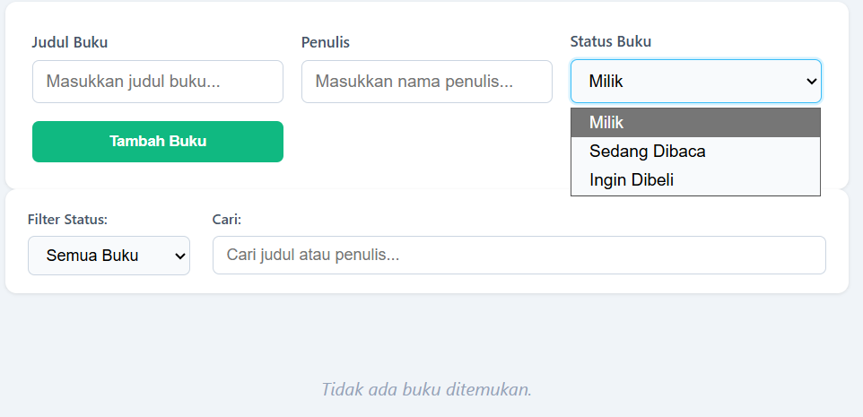
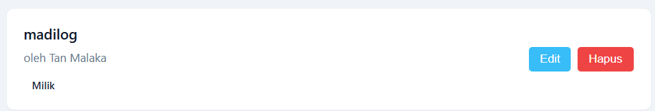
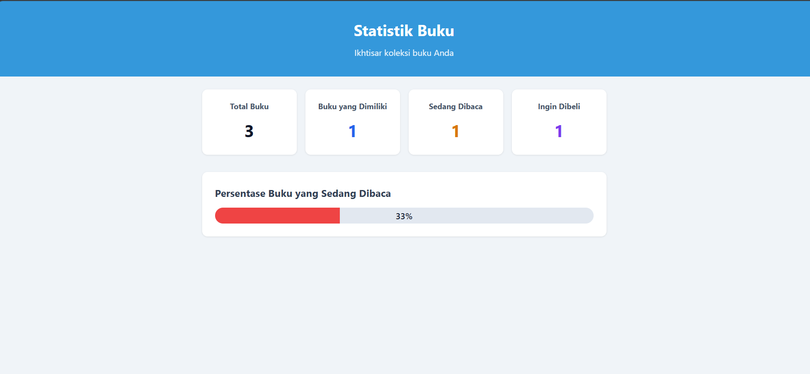

Manajemen Buku Pribadi

Aplikasi buat nyimpen buku pribadi — yang udah dimiliki, lagi dibaca, atau ingin dibeli.

Agit Fadillah | 124140157 | Prak PAW Pertemuan 3


Apa sih isinya?

Masih sering lupa buku apa aja? Atau penasaran berapa persen yang lagi dibaca? Aplikasi ini dirancang buat ngumpelin semua info buku pribadi.

Apa saja dilakukan:
Simpan buku (judul, penulis, status: milik / sedang baca / mau beli)
Cari & filter buku langsung update
Statistik otomatis: total, per status, persen lagi baca
Data tersimpan di localStorage — tetap ada walau refresh


Teknologi yang dipake:

React 19 : buat UI, lumayan cepet
Vite : build tool andalan
React Router DOM 7 : ganti halaman tanpa reload
Context API + hooks : ngatur state global & lokal
Custom hook : useLocalStorage buat nyimpen data, useBookStats buat ngitung statistik
React Testing Library + Vitest : ngetest
PropTypes : validasi props


Cara nyiapain project:

Pastiin Node.js v18+ terpasang.

git clone https://github.com/AgitFadillah/PengembanganAplikasiWeb.git

cd pemrograman_web_itera_124140157/AgitFadillah_124140157_pertemuan3

npm install

npm run dev

Buka di browser: http://localhost:5173


Struktur folder:

```
src/
├── assets/              : gambar/icons
├── components/
│   ├── BookForm/        : form isi buku
│   ├── BookItem/        : kartu buku di daftar
│   ├── BookList/        : daftar buku + filter
│   ├── BookFilter/      : dropdown filter + kolom cari
│   ├── Header/          : judul halaman
│   └── Navbar/          : menu navigasi atas
├── pages/
│   ├── Home/            : halaman utama
│   └── Stats/           : statistik
├── hooks/
│   ├── useLocalStorage.js
│   ├── useBookStats.js
│   └── useLocalStorage.test.js
├── context/
│   └── BookContext.jsx  : global state semua buku
├── App.jsx              : routing halaman
├── main.jsx             : masuk aplikasi
└── index.css            : style global
```


Fitur utama:

1. Kelola buku (tambah/edit/hapus)
2. Tiga status : milik, sedang baca, mau beli
3. Filter & pencarian langsung update
4. Statistik total, per status, persentase lagi baca
5. Navigasi cepat tanpa reload


Penjelasan singkat tiap fitur React:

Functional components : semua pakai fungsi biasa
React hooks : useState, useEffect, useMemo, useCallback
Context API : semua buku bisa diakses dari mana saja
Custom hooks : useLocalStorage & useBookStats
React Router DOM : pindah halaman antara Home dan Stats
PropTypes : validasi tipe data props


## Catatan Penting di Kode

- **`BookContext.jsx`**  
  Menggunakan error handling khusus agar proses debugging lebih mudah ketika terjadi kesalahan.

- **`useLocalStorage.js`**  
  Menggunakan `try/catch` untuk menangani error ketika `localStorage` bermasalah.

- **`useBookStats.js`**  
  Menggunakan `useMemo` agar statistik buku hanya dihitung ulang ketika data buku berubah.

- **`BookForm.jsx`**  
  Menggunakan `STATUS_OPTIONS` untuk menjelaskan tiga status buku.

- **`BookList.jsx`**  
  Memisahkan fitur filter dan pencarian ke dalam komponen agar kode lebih mudah dibaca.


## Hasil test:

**npm test**

Outputnya:

RUN  v5.0.5

Test Files  4 passed (4)
Tests  13 passed (13)
Start at  20:27:31
Duration  1.75s


Berikut rincian test:

File | Uji apa saja | Jumlah
---|---|---
BookForm.test.jsx | Render form, cek validasi kosong, cek submit | 3
BookItem.test.jsx | Render buku, klik edit, klik hapus | 3
BookFilter.test.jsx | Render filter, ganti filter, ketik pencarian | 3
useLocalStorage.test.js | Cek nilai awal, baca data ada, simpan baru | 4


Screenshot:

Beranda : 
Form tambah/edit buku : 
Daftar buku : 
Statistik : 

Modul Praktikum PAW — Teknik Informatika ITERA 2026/2027