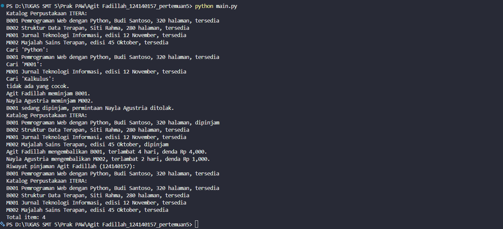

# Sistem Manajemen Perpustakaan Sederhana

Tugas Praktikum Pertemuan 5, Pemrograman Berorientasi Objek dengan Python.

## Identitas Mahasiswa

| Keterangan | Isi |
| --- | --- |
| Nama Lengkap | Agit Fadillah |
| NIM | 124140157 |
| Kelas Praktikum | RB |
| Mata Kuliah | Praktikum Pemrograman Web |
| Pertemuan | 5 (Python OOP) |

## Deskripsi Program

Program ini mensimulasikan pengelolaan koleksi sebuah perpustakaan: menambah item,
menampilkan katalog, mencari item berdasarkan id atau judul, meminjam item, dan
mengembalikan item beserta perhitungan dendanya.

Seluruh kode hanya memakai materi yang ada di modul Pertemuan 5. Tidak ada library
tambahan di luar modul bawaan Python (`abc`), dan tidak ada pustaka pihak ketiga.

### Penerapan Empat Pilar OOP

**1. Class dan Object**

Setiap entitas nyata diwakili satu class, dan objeknya dibuat dari class tersebut:

- `LibraryItem` (abstract) beserta turunannya `Book` dan `Magazine` di `library_item.py`
- `Member` di `member.py`, mewakili anggota perpustakaan
- `Library` di `library.py`, mewakili perpustakaan yang mengelola koleksi

**2. Inheritance (Pewarisan)**

`Book` dan `Magazine` sama-sama mewarisi `LibraryItem` dengan sintaks
`class Book(LibraryItem)`. Keduanya memanggil `super().__init__(id_item, judul)`
agar atribut dasar diinisialisasi oleh class induk, lalu menambahkan atribut
khasnya sendiri (`penulis` dan `jumlah_halaman` pada buku, `edisi` dan
`bulan_terbit` pada majalah).

**3. Encapsulation (Enkapsulasi)**

Tiga tingkat akses dipakai sesuai konvensi modul:

- Public: `id_item`, `judul`, `nama`, `nama_perpustakaan`
- Protected: `_daftar_pinjaman` pada `Member` dan `_daftar_anggota` pada `Library`
- Private: `__dipinjam` pada `LibraryItem` dan `__koleksi` pada `Library`

Atribut private terlindungi name mangling. Mengakses `item.__dipinjam` langsung
akan memicu `AttributeError`, sedangkan datanya tetap dapat dibaca sebagai
`item._LibraryItem__dipinjam`.

Perubahan data penting selalu lewat jalur yang tervalidasi:

- `is_dipinjam` pada `LibraryItem` memakai `@property` dan `@is_dipinjam.setter`,
  setter menolak nilai selain `True` atau `False` dengan `TypeError`
- `total_item` pada `Library` hanya memakai `@property` tanpa setter, jadi
  jumlah koleksi tidak dapat ditimpa dari luar secara sembarangan

**4. Polymorphism (Polimorfisme)**

`get_detail()` dan `hitung_denda()` adalah abstract method yang wajib
diimplementasikan setiap subclass, namun isinya berbeda sesuai jenis item.
Loop di `Library.tampilkan_katalog()` dan `Library.cari_item()` memanggil
`item.cetak_info()` untuk setiap item di koleksi tanpa memeriksa tipe objeknya:

```python
for item in self.__koleksi:
    item.cetak_info()
```

Rumus denda juga berbeda per tipe item, tetapi cara memanggilnya seragam:

| Jenis Item | Denda per Hari | Denda 4 Hari Terlambat |
| --- | --- | --- |
| Buku | Rp 1.000 | Rp 4.000 |
| Majalah | Rp 500 | Rp 2.000 |

Angka denda di atas adalah asumsi simulasi untuk keperluan praktikum, bukan tarif
perpustakaan yang sebenarnya.

### Abstract Class sebagai Kontrak

`LibraryItem` mewarisi `ABC` dari modul `abc` dan mendeklarasikan dua abstract
method. Konsekuensinya terlihat saat program dijalankan:

- `LibraryItem` tidak dapat diinstansiasi langsung karena masih memiliki method abstrak
- Subclass yang lupa mengimplementasikan salah satu abstract method juga otomatis
  dianggap abstrak dan gagal dibuat, dengan pesan `TypeError`

## Struktur Berkas

```text
Agit Fadillah_124140157_pertemuan5/
├── latihan/
│   ├── 01_everything_is_object.py
│   ├── 01_procedural_vs_oop.py
│   ├── 02_class_object.py
│   ├── 03_inheritance.py
│   ├── 04_encapsulation.py
│   ├── 05_polymorphism.py
│   └── 06_abstract_class.py
├── tugas_perpustakaan/
│   ├── library_item.py   # LibraryItem (abstract), Book, Magazine
│   ├── member.py         # Member, data anggota dan daftar pinjamannya
│   ├── library.py        # Library, pengelolaan koleksi dan sirkulasi
│   └── main.py           # Skrip eksekusi dan pengujian seluruh fitur
└── README.md
```

| Berkas | Isi |
| --- | --- |
| `library_item.py` | `LibraryItem(ABC)` dengan `get_detail()`, `hitung_denda()`, property `is_dipinjam`, method `cetak_info()`. Subclass `Book` dan `Magazine` mengoverride kedua abstract method. |
| `member.py` | `Member` dengan identitas anggota, daftar pinjaman protected, method `tambah_pinjaman()` dan `lihat_pinjaman()`. |
| `library.py` | `Library` dengan koleksi private, method `tambah_item()`, `tambah_member()`, `tampilkan_katalog()`, `cari_item()`, `pinjam_item()`, `kembalikan_item()`, dan property `total_item`. |
| `main.py` | Menjalankan seluruh alur: menambah item, menampilkan katalog, mencari item, meminjam, mengembalikan, dan mencetak riwayat anggota. |

## Panduan Menjalankan Program

Prasyarat: Python 3.10 atau lebih baru. Program tidak memerlukan instalasi paket
tambahan apa pun.

```bash
cd tugas_perpustakaan
python main.py
```

Untuk versi Python yang terpasang sebagai `python3`:

```bash
cd tugas_perpustakaan
python3 main.py
```

## Hasil Eksekusi

Seluruh keluaran di bawah adalah hasil menjalankan `python main.py` pada
`tugas_perpustakaan/` dengan Python 3.14.5.

```text
Katalog Perpustakaan ITERA:
B001 Pemrograman Web dengan Python, Budi Santoso, 320 halaman, tersedia
B002 Struktur Data Terapan, Siti Rahma, 280 halaman, tersedia
M001 Jurnal Teknologi Informasi, edisi 12 November, tersedia
M002 Majalah Sains Terapan, edisi 45 Oktober, tersedia
Cari 'Python':
B001 Pemrograman Web dengan Python, Budi Santoso, 320 halaman, tersedia
Cari 'M001':
M001 Jurnal Teknologi Informasi, edisi 12 November, tersedia
Cari 'Kalkulus':
tidak ada yang cocok.
Agit Fadillah meminjam B001.
Nayla Agustria meminjam M002.
B001 sedang dipinjam, permintaan Nayla Agustria ditolak.
Katalog Perpustakaan ITERA:
B001 Pemrograman Web dengan Python, Budi Santoso, 320 halaman, dipinjam
B002 Struktur Data Terapan, Siti Rahma, 280 halaman, tersedia
M001 Jurnal Teknologi Informasi, edisi 12 November, tersedia
M002 Majalah Sains Terapan, edisi 45 Oktober, dipinjam
Agit Fadillah mengembalikan B001, terlambat 4 hari, denda Rp 4,000.
Nayla Agustria mengembalikan M002, terlambat 2 hari, denda Rp 1,000.
Riwayat pinjaman Agit Fadillah (124140157):
B001 Pemrograman Web dengan Python, Budi Santoso, 320 halaman, tersedia
Katalog Perpustakaan ITERA:
B001 Pemrograman Web dengan Python, Budi Santoso, 320 halaman, tersedia
B002 Struktur Data Terapan, Siti Rahma, 280 halaman, tersedia
M001 Jurnal Teknologi Informasi, edisi 12 November, tersedia
M002 Majalah Sains Terapan, edisi 45 Oktober, tersedia
Total item: 4
```

## Screenshot Output
```markdown

```


