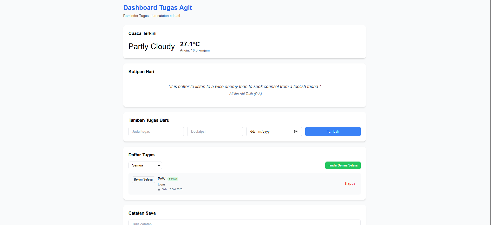

# Dashboard Tugas - Pertemuan 2

Nama: Agit Fadillah
NIM: 124140157

## Fungsi aplikasi

Aplikasi ini dashboard sederhana buat ngatur tugas kuliah sama catatan harian. Tugas bisa ditambah, ditandai selesai, difilter, dan dihapus. Ada juga widget cuaca ITERA sama kutipan motivasi yang diambil dari API. Semua data tugas dan catatan kesimpen otomatis di localStorage, jadi walau browser di-refresh datanya tetap ada.

Fitur-fiturnya:

- Tambah tugas (judul, deskripsi, deadline)
- Tandai tugas selesai / belum selesai, satu-satu atau sekaligus
- Filter tugas: semua, selesai, belum selesai
- Hapus tugas
- Tambah dan hapus catatan
- Widget cuaca ITERA (Open-Meteo API)
- Kutipan motivasi acak (DummyJSON API)

## Screenshot

## Fitur ES6+ yang dipakai

| Fitur | File dan baris |
| --- | --- |
| let dan const | const dipakai di semua file, contoh `js/app.js:6`, `js/main.js:4`, `js/modules/utils.js:1` |
| Arrow function | `js/modules/utils.js:1, 7, 12, 19, 27`, `js/main.js:4, 38, 72, 100, 117, 161` |
| Template literals | `js/app.js:41-58` (render item tugas), `js/main.js:9-15, 49-61, 89-97` |
| Destructuring object | `js/app.js:133`, `js/main.js:76, 104` |
| Spread operator | `js/app.js:99, 110, 154` (update array tanpa ubah data lama) |
| Default parameter | `js/app.js:5` |
| Class | `TaskItem` di `js/app.js:4`, `DashboardApp` di `js/app.js:62` |
| Static method | `fromJSON` di `js/app.js:19` |
| Method shorthand | method-method di dalam class, contoh `js/app.js:14, 26, 37` |
| Import dan export | `js/app.js:1-2, 164-165`, `js/main.js:1-2`, `js/modules/data.js`, `js/modules/utils.js` |
| Array method (map, filter) | `js/app.js:99, 104, 110, 116, 124, 134-135, 140, 145`, `js/main.js:19, 51` |
| Async await dan fetch | `js/app.js:69-83, 85-94`, `js/main.js:72-98, 100-115` |

Cara jalanin: buka folder ini di VS Code, klik kanan `index.html`, pilih Open with Live Server.
